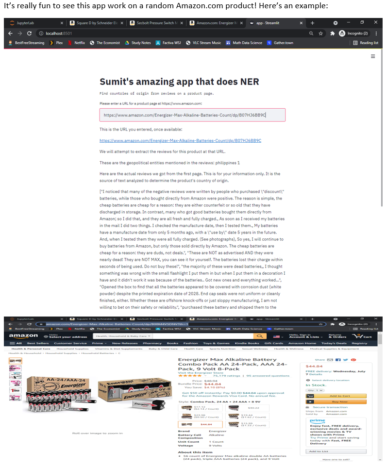

# MadeWhere Made-In-What-Country Guesser for Amazon.com and Similar Sites

This is a standalone Web browser extension.

Upon visiting an Amazon.com product page, this extension will guess and show what country the product was made in based on page contents.

One codebase, one `manifest.json` (Manifest V3), runs in **Chrome** and **Firefox 128+**.
On an Amazon.com product page it estimates which country the product is made in and shows it
as a badge on the page and as a ranked list (with the supporting text) in the toolbar popup.

## Install for testing

**Chrome / Edge / Brave:** `chrome://extensions` → Developer mode → *Load unpacked* → pick this folder.

**Firefox:** `about:debugging#/runtime/this-firefox` → *Load Temporary Add-on…* → pick `manifest.json`.
(Or `npx web-ext run`.) Firefox MV3 treats site access as a permission: if no badge appears,
open `about:addons` → the extension → *Permissions* and allow access to amazon.com.

**Package for the stores:** `./build.sh` → `dist/madewhere.zip` (the same zip serves both).
Change the `gecko.id` in `manifest.json` to your own before submitting to AMO.

## How it works

1. **Read the page's rendered text only.** A content script runs inside the page, so it sees what Amazon's JavaScript
   has already put in the DOM. Lazily loaded sections are seen. No requests are made, nothing is scraped, and nothing leaves the browser.
   A `MutationObserver` re-scans (throttled to every 3 s) as lazy sections load. The delivery widget, buy box, "customers also viewed" carousels and reviewer locations ("Reviewed in Canada") are excluded or heavily discounted.
2. **Segments.** Text is grouped into the smallest block that keeps a label with its value (table row,
   list item, paragraph), so `Country of Origin` + `China` in separate cells is read as one phrase.
   Navigation, buy box, delivery widget, "customers also viewed" carousels, footer and review dates are
   excluded (they describe the shopper, the seller or other products).
3. **NER (`src/ner.js`).** A gazetteer of the 193 UN member states + 2 observers + other observers (`src/countries.js`) with
   names, aliases (Viet Nam, Ivory Coast, Czech Republic…), safe abbreviations (USA, UK, UAE, PRC…) and ISO
   alpha-2/alpha-3 codes. Longest match wins (*Papua New Guinea* ≠ *Guinea*; *Nigeria* ≠ *Niger*).
   Ambiguous strings are only accepted in context: `IN`, `IT`, `CAN`, `US` need to follow "Made in" /
   "Country of Origin"; *Georgia, Jordan, Turkey, Chad, Guinea* need a manufacturing cue; lowercase "china"
   (tableware) and "New Mexico" are rejected.
4. **Role labelling.** The words around each country decide its weight:
   explicit *Country of Origin* field (100) > "Made in / Product of / Assembled in" (×8) > near
   manufacturer/factory words (×3) > bare mention (×1) > "Designed in" (×0.15) > "Ships from / Sold by /
   Warranty valid in…" (×0.05). Weight is then multiplied by where it appears (details/bullets/description
   3, title 2, reviews 1 with a cap, anything else 0.7).
5. **Confidence.** *high* = the listing's own origin field dominates; *medium* = strong phrases agree;
   *low* = weak or review-only evidence; nothing is shown otherwise.
6. **Output.** An on-page badge shows the top guess and a confidence level. The toolbar popup shows the ranked candidates and the page text behind each.

## Limits worth knowing

- It is a text heuristic. Many listings never state an origin; sellers can write anything.
- Amazon's element ids change. If a region stops being excluded/weighted properly, edit
  `EXCLUDE_SELECTOR` / `ZONES` at the top of `src/content.js`; the shipping/sales wording rules are a second line of defence.
- Only the UN list is recognised, with adjustments. Add rows to `src/countries.js` if you want more.
- Cities and regions ("Shenzhen", "Guangdong") are not mapped to countries; "Made in Shenzhen, China" works only because China is also written.
- Other Amazon domains: add them to `host_permissions` and `content_scripts.matches`.
- The page-region rules rely on Amazon's element IDs, which I could only check against my mock page. If Amazon changes them, update EXCLUDE_SELECTOR and ZONES at the top of src/content.js.
- In Firefox you may need to allow site access for amazon.com under about:addons → Permissions. The README has the install steps for both browsers. Before submitting to the Firefox store, change gecko.id in manifest.json to your own.

## Tests

`npm install && npm test` (Node 20+). 12 unit tests for the NER and 5 end-to-end tests that run the real
content scripts against an Amazon-shaped DOM in jsdom.

# Obsolete: MadeWhere Server

The code in `madewhere_server` is obsolete. It was a heavyweight Streamlit Web server one would have to run on their own server or computer to put a URL of an Amazon.com product page to get a guess for what country the product was made in based on page contents.

